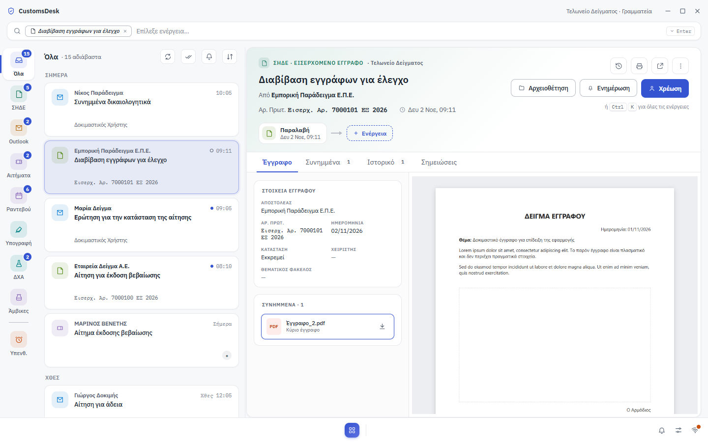
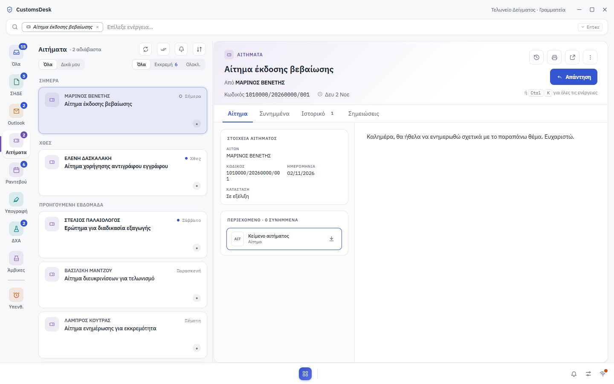
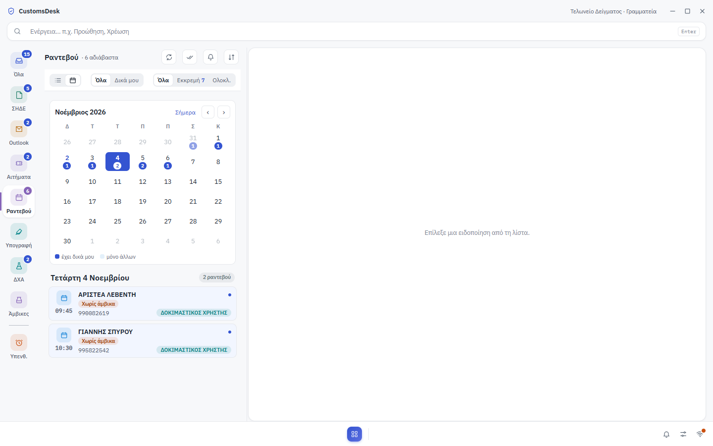
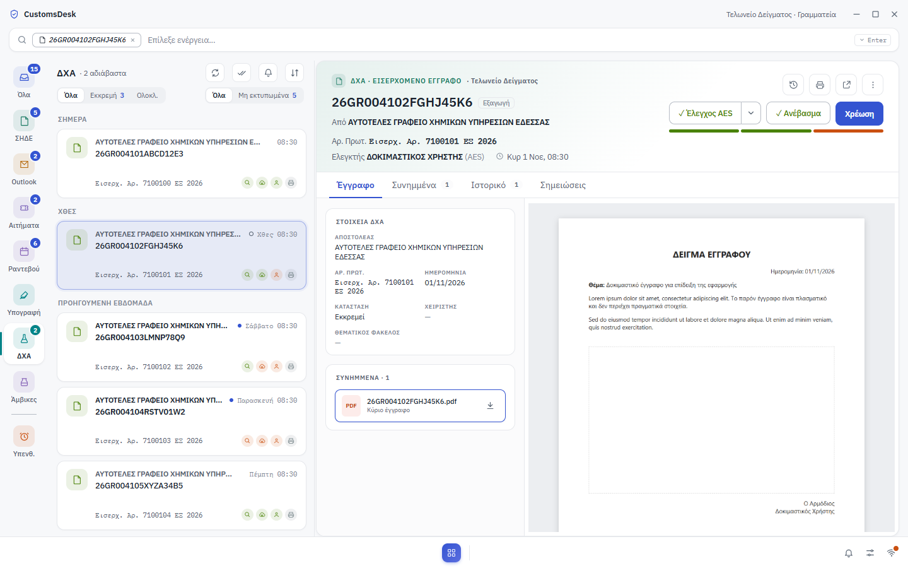
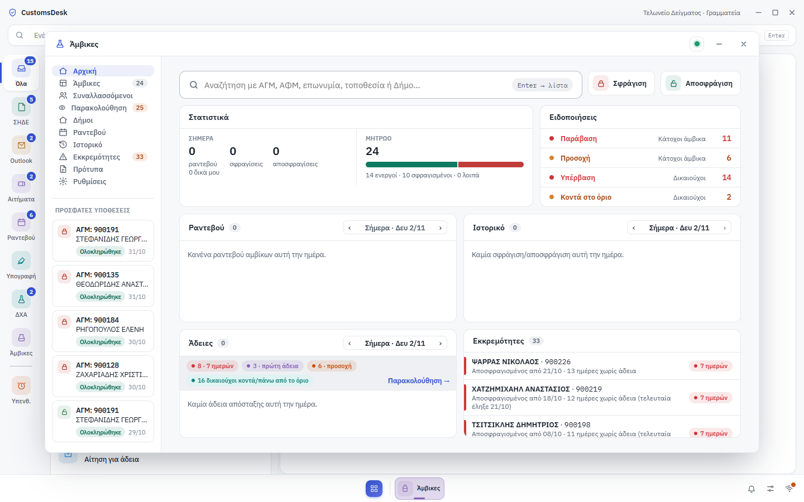
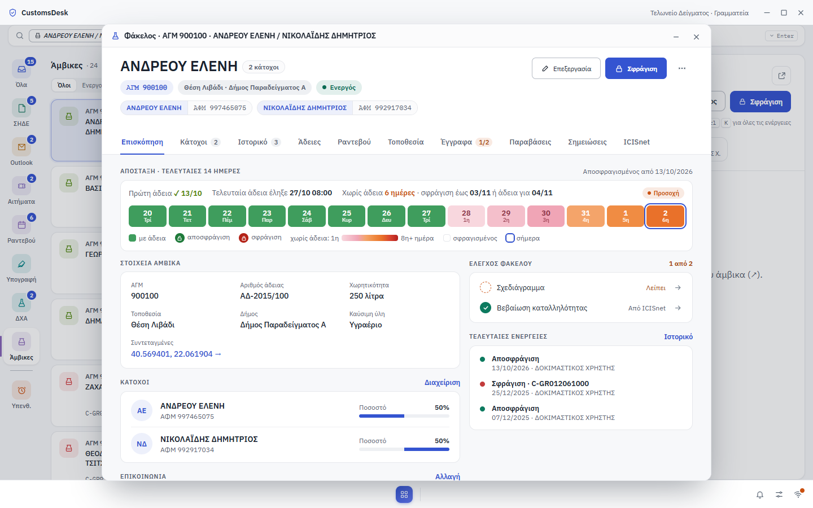
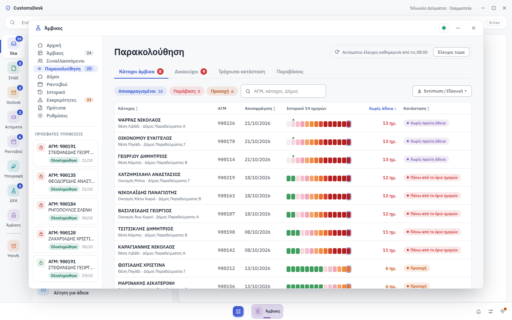
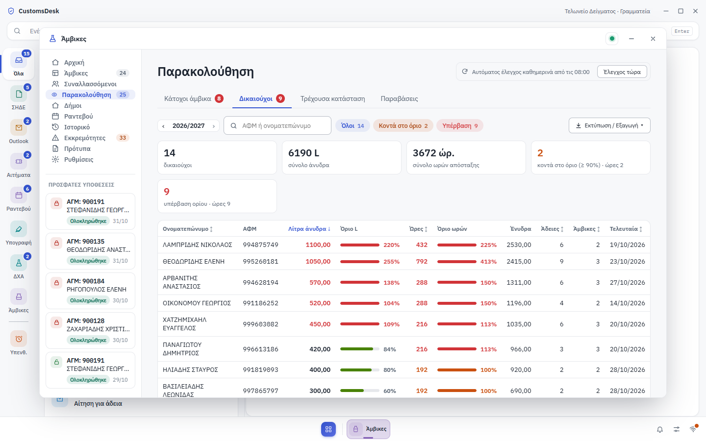
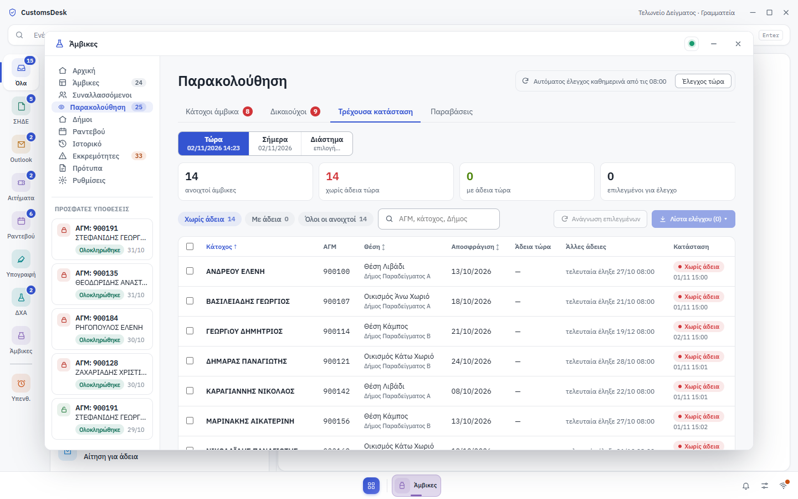
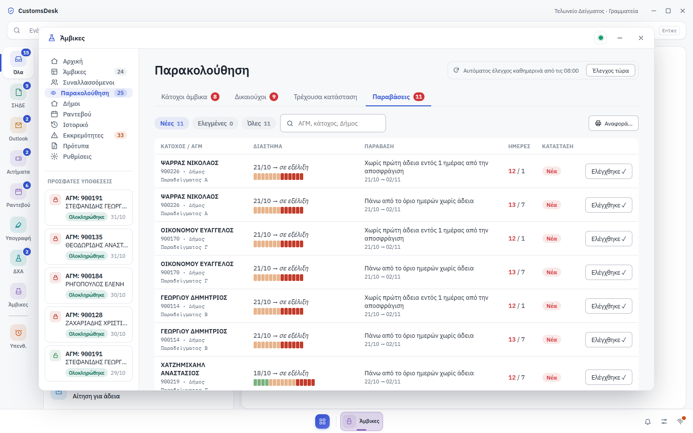

# CustomsDesk-releases

Εκδόσεις της εφαρμογής **CustomsDesk** — κεντρικό γραφείο εργασίας για τη Γραμματεία του Τελωνείου (ΣΗΔΕ, Outlook, Αιτήματα, ΔΧΑ/ICISnet, Άμβικες).

Τα στιγμιότυπα παρακάτω χρησιμοποιούν δοκιμαστικά δεδομένα.

## Στιγμιότυπα

### Αρχική

### Αιτήματα

### Ραντεβού

### ΔΧΑ — Ροή

### Άμβικες

### Παρακολούθηση Αμβίκων

